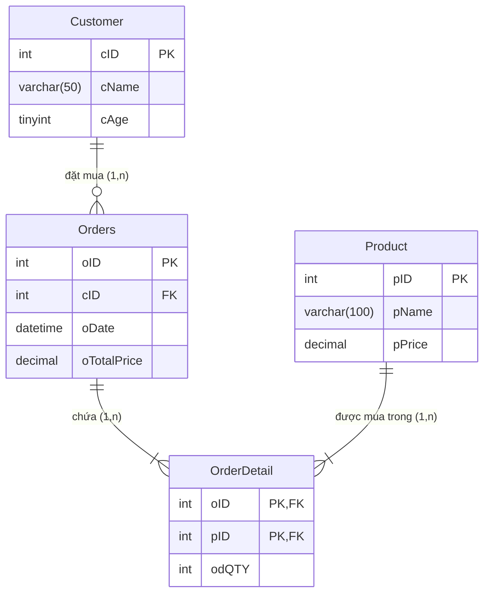

# [Bài tập] Xây dựng cơ sở dữ liệu quản lý bán hàng (QuanLyBanHang)

## 1. Mục tiêu
- Luyện tập kỹ năng phân tích bài toán thực tế và xây dựng CSDL quan hệ trong MySQL.
- Khai báo các bảng, thiết lập đầy đủ khóa chính (`PRIMARY KEY`), khóa ngoại (`FOREIGN KEY`) và các ràng buộc dữ liệu (`NOT NULL`, `CHECK`, `DEFAULT`).
- Nắm bắt mô hình nghiệp vụ bán hàng kinh điển: Khách hàng (`Customer`) - Hóa đơn/Đơn hàng (`Order`) - Chi tiết hóa đơn (`OrderDetail`) - Sản phẩm (`Product`).

---

## 2. Mô tả yêu cầu bài toán
Cơ sở dữ liệu có tên **`QuanLyBanHang`** gồm 4 bảng:

1. **Bảng `Customer` (Khách hàng)**:
   - `cID`: Mã khách hàng (INT, Khóa chính, Auto Increment).
   - `cName`: Tên khách hàng (VARCHAR(50), NOT NULL).
   - `cAge`: Tuổi khách hàng (TINYINT, CHECK `cAge > 0`).

2. **Bảng `Orders` (Hóa đơn mua hàng)**:
   - `oID`: Số hóa đơn / Mã đơn hàng (INT, Khóa chính, Auto Increment).
   - `cID`: Mã khách hàng mua hàng (INT, Khóa ngoại tham chiếu đến `Customer(cID)`).
   - `oDate`: Ngày mua hàng (DATETIME, NOT NULL).
   - `oTotalPrice`: Tổng tiền hóa đơn (INT / DECIMAL(15,2), có thể để NULL khi mới tạo đơn và tính sau).

3. **Bảng `Product` (Sản phẩm)**:
   - `pID`: Mã sản phẩm (INT, Khóa chính, Auto Increment).
   - `pName`: Tên sản phẩm (VARCHAR(100), NOT NULL).
   - `pPrice`: Giá tiền sản phẩm (INT / DECIMAL(15,2), NOT NULL, CHECK `pPrice >= 0`).

4. **Bảng `OrderDetail` (Chi tiết hóa đơn)**:
   - Bảng liên kết Nhiều - Nhiều ($N-N$) giữa `Orders` và `Product`.
   - `oID`: Mã hóa đơn (INT, Khóa ngoại tham chiếu đến `Orders(oID)`).
   - `pID`: Mã sản phẩm (INT, Khóa ngoại tham chiếu đến `Product(pID)`).
   - `odQTY`: Số lượng mua (INT, NOT NULL, CHECK `odQTY > 0`).
   - Khóa chính phức hợp: `PRIMARY KEY (oID, pID)`.

---

## 3. Sơ đồ thực thể liên kết (ERD)

---

## 4. Hướng dẫn thực thi

Mở MySQL Workbench, tạo tab truy vấn mới và chạy file [`quan_ly_ban_hang.sql`](quan_ly_ban_hang.sql). Toàn bộ CSDL và cấu trúc bảng sẽ được khởi tạo với đầy đủ ràng buộc khóa và dữ liệu mẫu.
