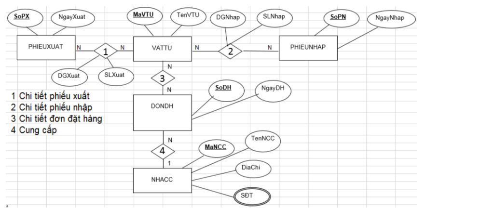
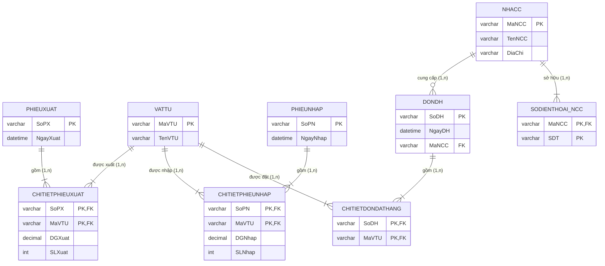

# [Bài tập] Chuyển đổi mô hình ERD sang mô hình quan hệ

## 1. Mục tiêu
- Nắm vững nguyên tắc chuyển đổi từ mô hình thực thể liên kết (ERD) sang mô hình dữ liệu quan hệ (Relational Model).
- Xử lý các loại quan hệ: $1 - N$, $N - N$ (tạo bảng trung gian với khóa chính phức hợp).
- Xử lý thuộc tính đa trị (Multivalued Attribute) bằng cách tách thành bảng riêng biệt theo chuẩn 1NF.
- Sinh script SQL DDL tạo cơ sở dữ liệu hoàn chỉnh trên MySQL.

---

## 2. Mô hình ERD gốc

---

## 3. Các bước phân tích và chuyển đổi chi tiết

### Bước 1: Xác định các thực thể cơ bản
1. **`PHIEUXUAT`**:
   - Khóa chính: `SoPX`
   - Thuộc tính khác: `NgayXuat`
2. **`VATTU`**:
   - Khóa chính: `MaVTU`
   - Thuộc tính khác: `TenVTU`
3. **`PHIEUNHAP`**:
   - Khóa chính: `SoPN`
   - Thuộc tính khác: `NgayNhap`
4. **`DONDH`** (Đơn đặt hàng):
   - Khóa chính: `SoDH`
   - Thuộc tính khác: `NgayDH`
5. **`NHACC`** (Nhà cung cấp):
   - Khóa chính: `MaNCC`
   - Thuộc tính khác: `TenNCC`, `DiaChi`

---

### Bước 2: Xác định các mối quan hệ và tạo bảng

1. **Quan hệ 1: Chi tiết phiếu xuất (`PHIEUXUAT` $N - N$ `VATTU`)**
   - Đây là quan hệ Nhiều - Nhiều ($N - N$) có thuộc tính riêng: `DGXuat` (Đơn giá xuất), `SLXuat` (Số lượng xuất).
   - **Sinh ra bảng trung gian**: `CHITIETPHIEUXUAT`
   - Cấu trúc: `(SoPX, MaVTU, DGXuat, SLXuat)`
   - Khóa chính phức hợp: `PRIMARY KEY (SoPX, MaVTU)`
   - Khóa ngoại:
     - `SoPX` tham chiếu `PHIEUXUAT(SoPX)`
     - `MaVTU` tham chiếu `VATTU(MaVTU)`

2. **Quan hệ 2: Chi tiết phiếu nhập (`VATTU` $N - N$ `PHIEUNHAP`)**
   - Quan hệ Nhiều - Nhiều ($N - N$) có thuộc tính riêng: `DGNhap` (Đơn giá nhập), `SLNhap` (Số lượng nhập).
   - **Sinh ra bảng trung gian**: `CHITIETPHIEUNHAP`
   - Cấu trúc: `(SoPN, MaVTU, DGNhap, SLNhap)`
   - Khóa chính phức hợp: `PRIMARY KEY (SoPN, MaVTU)`
   - Khóa ngoại:
     - `SoPN` tham chiếu `PHIEUNHAP(SoPN)`
     - `MaVTU` tham chiếu `VATTU(MaVTU)`

3. **Quan hệ 3: Chi tiết đơn đặt hàng (`VATTU` $N - N$ `DONDH`)**
   - Quan hệ Nhiều - Nhiều ($N - N$).
   - **Sinh ra bảng trung gian**: `CHITIETDONDATHANG`
   - Cấu trúc: `(SoDH, MaVTU)`
   - Khóa chính phức hợp: `PRIMARY KEY (SoDH, MaVTU)`
   - Khóa ngoại:
     - `SoDH` tham chiếu `DONDH(SoDH)`
     - `MaVTU` tham chiếu `VATTU(MaVTU)`

4. **Quan hệ 4: Cung cấp (`NHACC` $1 - N$ `DONDH`)**
   - Một nhà cung cấp có thể có nhiều đơn đặt hàng ($1 - N$).
   - **Giải pháp**: Thêm khóa ngoại `MaNCC` vào bảng bên Nhiều là `DONDH`.
   - Bảng `DONDH`: `(SoDH, NgayDH, MaNCC)`

---

### Bước 3: Xử lý thuộc tính đa trị (Multivalued Attribute)
- Thuộc tính `SĐT` trong thực thể `NHACC` có viền kép (thuộc tính đa trị - 1 nhà cung cấp có thể có nhiều số điện thoại).
- Để đạt chuẩn 1NF, tách thành bảng riêng: **`SODIENTHOAI_NCC`** (hoặc `NHACC_SDT`).
- Cấu trúc: `(MaNCC, SDT)`
- Khóa chính phức hợp: `PRIMARY KEY (MaNCC, SDT)`
- Khóa ngoại: `MaNCC` tham chiếu `NHACC(MaNCC)`

---

### Bước 4: Danh sách các bảng sau khi chuyển đổi hoàn tất (6 Bảng)

1. `PHIEUXUAT` (**SoPX**, NgayXuat)
2. `VATTU` (**MaVTU**, TenVTU)
3. `CHITIETPHIEUXUAT` (**<u>SoPX</u>**, **<u>MaVTU</u>**, DGXuat, SLXuat)
4. `PHIEUNHAP` (**SoPN**, NgayNhap)
5. `CHITIETPHIEUNHAP` (**<u>SoPN</u>**, **<u>MaVTU</u>**, DGNhap, SLNhap)
6. `DONDH` (**SoDH**, NgayDH, *MaNCC*)
7. `CHITIETDONDATHANG` (**<u>SoDH</u>**, **<u>MaVTU</u>**)
8. `NHACC` (**MaNCC**, TenNCC, DiaChi)
9. `SODIENTHOAI_NCC` (**<u>MaNCC</u>**, **<u>SDT</u>**)

---

## 5. Sơ đồ thực thể liên kết (Mermaid ERD)

