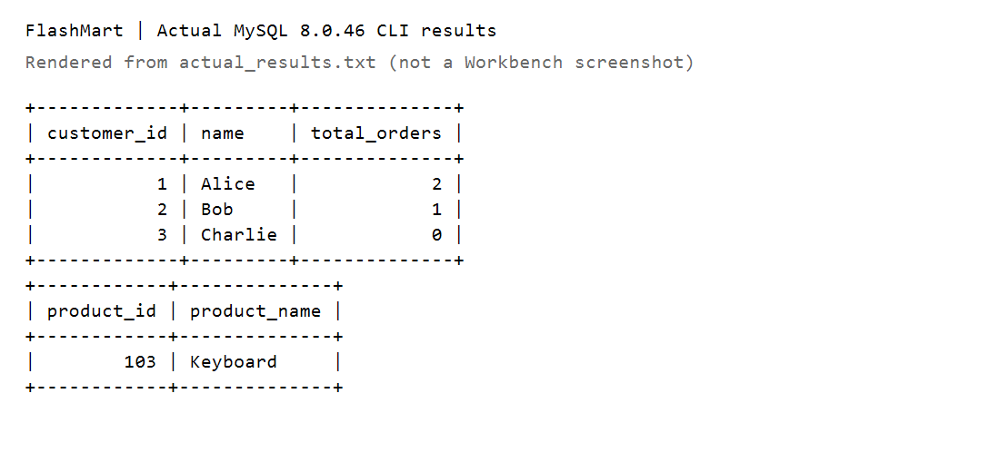

# FlashMart — Khủng hoảng báo cáo JOIN

## Chạy bài

Mở `flashmart_reports.sql` trong MySQL Workbench và thực thi toàn bộ trên CSDL thực hành chưa có các bảng Customers, Products, Orders. Script không xóa bảng hay dữ liệu có sẵn. Chỉ chạy phần SELECT nếu đã nạp bộ dữ liệu mẫu; chạy lại toàn bộ sẽ báo bảng đã tồn tại.

Trong mô hình đề bài, mỗi dòng Orders là một đơn hàng với một sản phẩm. Hai index trên khóa nối hỗ trợ tra cứu khi dữ liệu tăng; cần xem execution plan trước khi kết luận hiệu năng.

## Kết quả yêu cầu

Marketing giữ Customers bên trái, Orders bên phải, trả đủ 3 khách:

| customer_id | name | total_orders |
| --- | --- | --- |
| 1 | Alice | 2 |
| 2 | Bob | 1 |
| 3 | Charlie | 0 |

Kho vận giữ Products bên trái, Orders bên phải và lọc khóa đơn NULL:

| product_id | product_name |
| --- | --- |
| 103 | Keyboard |

Charlie là nhóm nhận voucher 50% theo nghiệp vụ; bài chỉ lập báo cáo, không phát voucher.

## Tài liệu và nộp bài

- `flashmart_reports.sql`: tạo bảng, dữ liệu mẫu và hai báo cáo.
- `join_analysis.md`: giải trình dưới 150 từ.
- `ai_prompt_log.md`: nội dung trao đổi lý thuyết và công khai phạm vi AI hỗ trợ.
- `FlashMart_Submission.zip`: gói bài nộp.

## Đối chiếu thực tế

Đã chạy toàn bộ script bằng MySQL 8.0.46 trên một instance tạm riêng. Kết quả khớp cả hai báo cáo: 3 dòng khách hàng (2, 1, 0 đơn) và 1 dòng sản phẩm Keyboard. Ba bảng đầu vào đều có 3 dòng.

`actual_results.txt` là output CLI thực tế. `actual_results.png` là ảnh dựng từ chính output này, không phải ảnh chụp MySQL Workbench.

Đề yêu cầu ảnh chụp Result Grid trong Workbench; gói hiện có bằng chứng CLI và ảnh xuất từ output. Nếu giảng viên yêu cầu đúng giao diện Workbench, cần chạy lại và chụp hai result grid.
