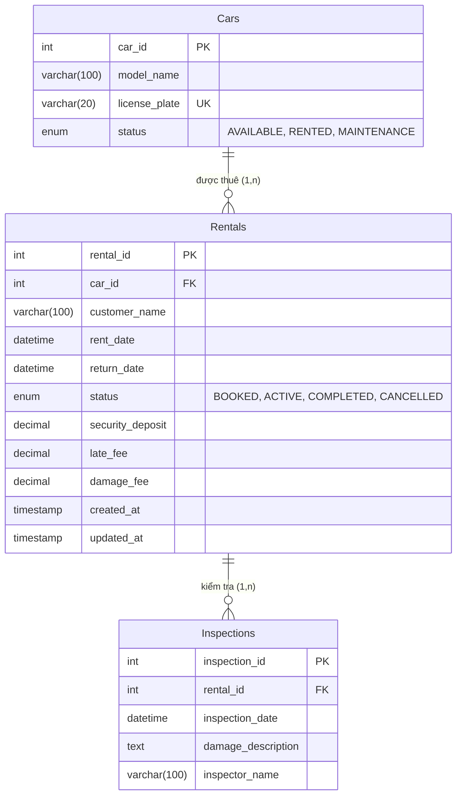

# [Bài tập] Sự Cố Bốc Hơi Lợi Nhuận Tại AutoRide - Khi Dữ Liệu "Lệch Pha" Với Quy Trình Thực Tế

## 1. Giới thiệu Dự án
Dự án nhằm tái cấu trúc và chuẩn hóa mô hình dữ liệu cho startup cho thuê xe tự lái **AutoRide**, khắc phục sự cố thất thoát tài chính và bốc hơi lợi nhuận do hệ thống cơ sở dữ liệu cũ (**Legacy Database**) không lưu vết các nhánh rẽ phạt trễ giờ (`late_fee`) và bồi thường hư hỏng (`damage_fee`) được mô tả trong **UML Activity Diagram**.

---

## 2. Cấu trúc Thư mục Nộp bài
- [`autoride_db.sql`](autoride_db.sql): File kịch bản SQL hoàn chỉnh chứa DDL định nghĩa lại cấu trúc bảng, Trigger chặn kiểm tra xe khi chưa nhận xe, và DML mô phỏng toàn bộ quy trình thuê - trả - phạt hư hỏng và tính tiền hoàn cọc.
- [`er_activity_mapping.md`](er_activity_mapping.md): Đoạn phân tích ngắn giải thích lý do tại sao cột `damage_fee` là bắt buộc phải có để hệ thống toàn vẹn và bảng đối chiếu 3 Data Gaps.
- [`ai_prompt_log.md`](ai_prompt_log.md): Nhật ký các câu hỏi kỹ thuật đã trao đổi với AI (lựa chọn DECIMAL, xử lý giá trị NULL, quan hệ 1-1 vs 1-N cho bảng Inspections, và Database Trigger).

---

## 3. Sơ đồ Thực thể Liên kết (ERD) sau Chuẩn hóa

---

## 4. Các câu hỏi bảo vệ thiết kế (Vấn đáp / Q&A)

### Câu 1: Tại sao việc tách dữ liệu kiểm tra xe ra một bảng riêng (`Inspections`) lại tốt hơn việc nhồi nhét một cột `damage_description` trực tiếp vào bảng `Rentals`?
- **Trả lời**: 
  1. **Tuân thủ chuẩn hóa dữ liệu (Normalization)**: Tách riêng thực thể biên bản kiểm tra (nghiệp vụ vận hành, kỹ thuật) khỏi giao dịch hợp đồng thuê xe (nghiệp vụ tài chính).
  2. **Tiết kiệm tài nguyên**: Đa số các chuyến xe trả về nguyên vẹn không có hư hỏng; việc để `damage_description` dạng `TEXT` trong `Rentals` sẽ tạo ra rất nhiều trường `NULL` lãng phí bộ nhớ.
  3. **Khả năng mở rộng**: Trong thực tế, một hợp đồng có thể có nhiều lần kiểm tra (kiểm tra lúc giao xe - check out, và kiểm tra lúc nhận lại xe - check in). Thiết kế bảng riêng cho phép hỗ trợ nhiều lần kiểm tra linh hoạt mà không cần sửa cấu trúc bảng.

### Câu 2: Nếu muốn quy định: Khi hợp đồng đang ở trạng thái `BOOKED` (khách chưa nhận xe) thì không ai được phép insert dữ liệu vào bảng `Inspections`, ta dùng cơ chế nào?
- **Trả lời**: Sử dụng **`BEFORE INSERT TRIGGER`** trên bảng `Inspections`. Trigger kiểm tra giá trị `Rentals.status` của hợp đồng đó. Nếu bằng `'BOOKED'`, thực thi lệnh `SIGNAL SQLSTATE '45000' SET MESSAGE_TEXT = '...';` để hủy lệnh chèn và báo lỗi ngay tại tầng cơ sở dữ liệu.

### Câu 3: Sự thiếu đồng bộ giữa Activity Diagram do BA vẽ và ERD do Dev thiết kế thường dẫn đến những hậu quả gì về mặt trải nghiệm người dùng cuối (UX)?
- **Trả lời**:
  1. **Tính năng bị treo/lỗi (Bug/Crash)**: Ứng dụng hiển thị nút bấm phạt cọc hoặc biên bản kiểm tra nhưng khi bấm submit thì hệ thống báo lỗi 500 do Database không có trường tương ứng để lưu trữ.
  2. **Tranh cãi và mất lòng tin**: Khách hàng thấy ứng dụng hiển thị trả xe thành công và trừ tiền cọc không rõ lý do, trong khi nhân viên lại phải giải thích bằng miệng hoặc ghi chép giấy tờ thủ công, gây ức chế và làm giảm uy tín của thương hiệu.
