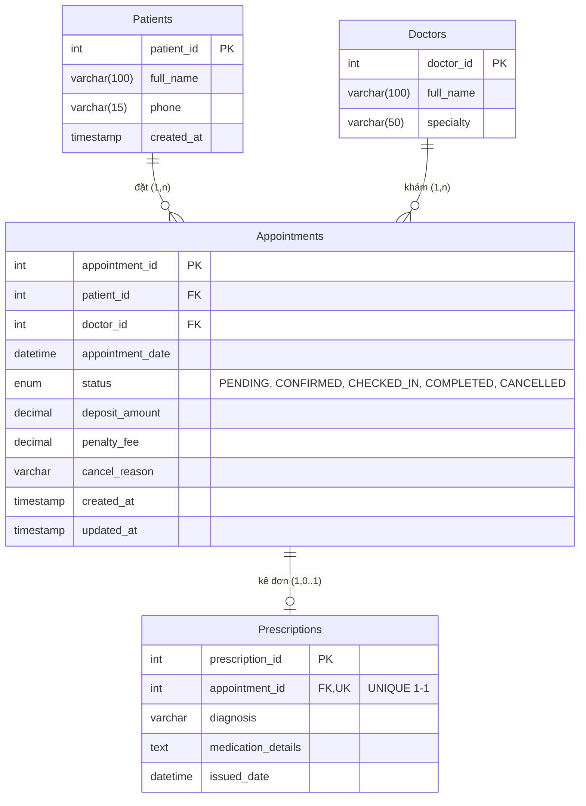

# [Thực hành] Khủng Hoảng Tại Phòng Khám HealthSync - Khi Lập Trình Viên "Bỏ Quên" Nghiệp Vụ

## 1. Giới thiệu Dự án
Dự án nhằm tái cấu trúc và chuẩn hóa cơ sở dữ liệu cho phòng khám đa khoa **HealthSync**, loại bỏ các lỗ hổng dữ liệu (Data Gaps) nghiêm trọng từ bản thiết kế cũ (**Legacy Database**) để tương thích 100% với **UML Activity Diagram** do BA cung cấp.

---

## 2. Cấu trúc Thư mục Nộp bài
- [`healthsync_db.sql`](healthsync_db.sql): File kịch bản SQL hoàn chỉnh bao gồm DDL tạo bảng chuẩn hóa, Trigger ngăn chặn kê đơn trái phép, và DML mô phỏng 2 kịch bản vận hành thực tế.
- [`consistency_report.md`](consistency_report.md): Báo cáo phân tích khoảng cách dữ liệu (Gap Analysis) chỉ ra 3 điểm vênh cốt tử giữa nghiệp vụ thực tế và thiết kế cũ.
- [`ai_prompt_log.md`](ai_prompt_log.md): Nhật ký tương tác kỹ thuật với AI (Lý giải Anti-pattern Boolean, sai số làm tròn số học tài chính, và Database Trigger).

---

## 3. Sơ đồ Thực thể Liên kết (ERD) sau Chuẩn hóa

---

## 4. Các câu hỏi bảo vệ thiết kế (Vấn đáp / Q&A)

### Câu 1: Làm thế nào chặn kê đơn khi lịch hẹn chưa ở trạng thái `COMPLETED`?
- **Giải pháp**: Thiết lập `BEFORE INSERT TRIGGER` tên `trg_before_insert_prescription` trên bảng `Prescriptions`. Trigger sẽ kiểm tra trạng thái của `Appointments.status`. Nếu khác `COMPLETED`, phát sinh ngoại lệ `SIGNAL SQLSTATE '45000'` từ chối thao tác ngay tại tầng Database.

### Câu 2: Tại sao lưu `penalty_fee` quan trọng đối với tính toàn vẹn hệ thống và kế toán?
- **Giải thích**: Nếu không có `penalty_fee`, khi bệnh nhân hủy lịch, số tiền phạt trừ vào tiền cọc sẽ biến mất khỏi sổ sách kế toán. Cuối tháng khi đối soát doanh thu thực tế và dòng tiền hoàn trả (`deposit_amount - penalty_fee`), phòng khám sẽ rơi vào tình trạng chênh lệch công nợ, không thể chứng minh nguồn thu phí phạt hợp pháp và gây tranh chấp tài chính.

### Câu 3: Sự nhất quán giữa UML Activity Diagram và ERD có vai trò gì?
- **Giải thích**: Activity Diagram mô tả **động thái và hành vi** (Behavior/Workflow) của doanh nghiệp theo thời gian, còn ERD mô tả **cấu trúc tĩnh** (Data Structure) để lưu trữ các trạng thái đó. Sự nhất quán giữa hai biểu đồ là cầu nối quyết định giúp Developer xây dựng cơ sở dữ liệu hỗ trợ 100% nghiệp vụ của BA, ngăn ngừa rủi ro phải đập đi xây lại hệ thống khi đã triển khai.
