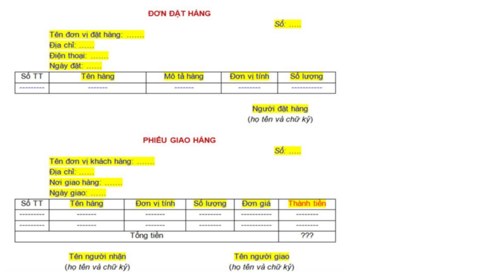
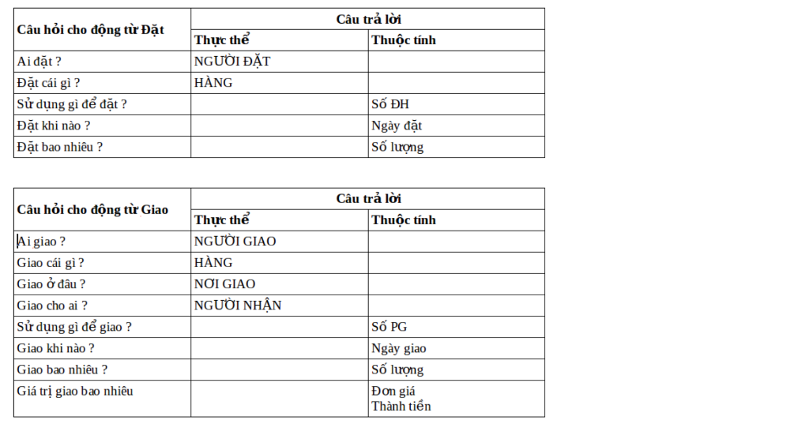
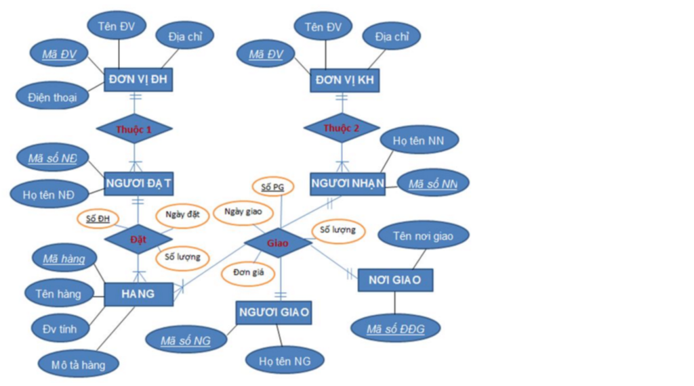
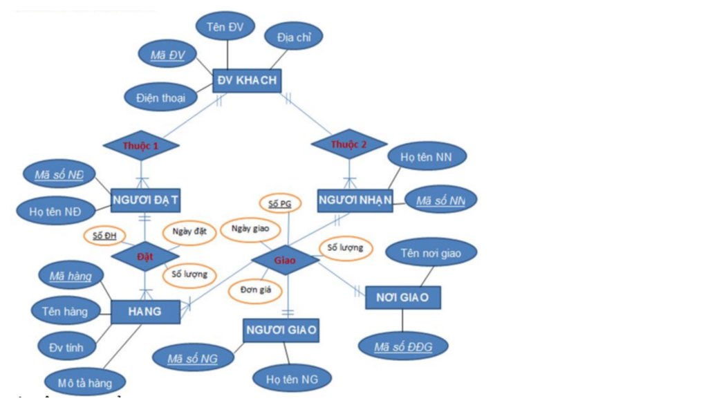
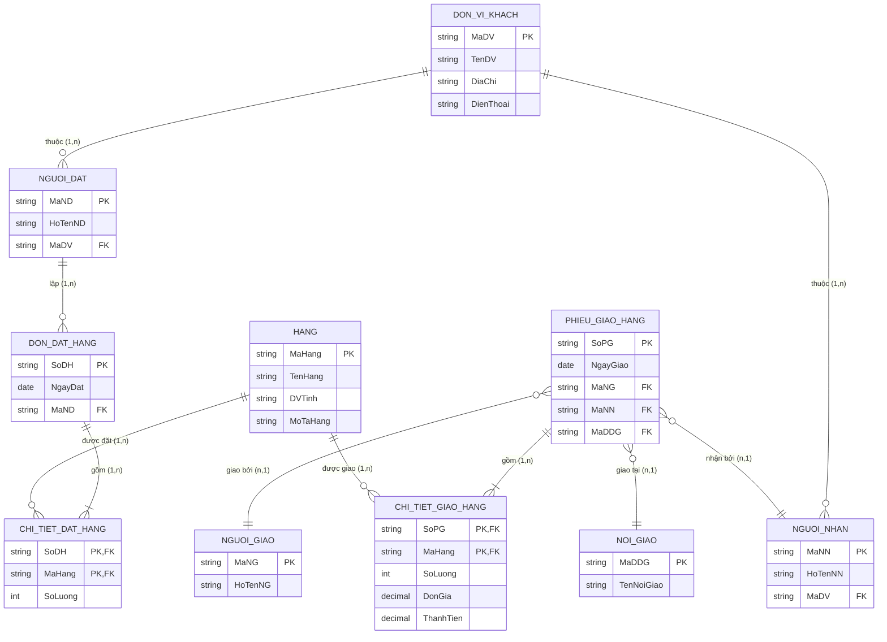

# [Thực hành] Quản lý đơn đặt hàng - Thiết kế mô hình ERD

## 1. Mục tiêu
- Phân tích nghiệp vụ quản lý đơn đặt hàng và phiếu giao hàng từ các biểu mẫu thực tế.
- Xác định đầy đủ thực thể (Entities), thuộc tính (Attributes) và các mối quan hệ (Relationships).
- Xây dựng và chuẩn hóa sơ đồ thực thể liên kết (ERD - Entity Relationship Diagram).
- Chuyển đổi mô hình ERD thành lược đồ cơ sở dữ liệu quan hệ (Relational Schema) và triển khai bảng trên MySQL.

---

## 2. Phân tích bài toán

### 2.1. Biểu mẫu thực tế
Dựa vào 2 mẫu chứng từ: **Đơn đặt hàng** và **Phiếu giao hàng**:

#### Đơn đặt hàng gồm:
- Số đơn hàng (`Số ĐH`), Tên đơn vị đặt hàng (`Tên ĐV`), Địa chỉ, Điện thoại, Ngày đặt.
- Chi tiết mặt hàng: Tên hàng, Mô tả, Đơn vị tính (`Đv tính`), Số lượng.
- Người đặt hàng (`Họ tên NĐ`).

#### Phiếu giao hàng gồm:
- Số phiếu giao (`Số PG`), Tên đơn vị nhận hàng (`Tên ĐV`), Địa chỉ, Nơi giao hàng (`Tên nơi GH`), Ngày giao.
- Chi tiết mặt hàng giao: Tên hàng, Đơn vị tính, Số lượng, Đơn giá, Thành tiền.
- Người nhận (`Họ tên NN`), Người giao (`Họ tên NG`).

---

### 2.2. Xác định Thực thể & Thuộc tính
1. **ĐƠN VỊ ĐẶT HÀNG (`DON_VI_DH`)**: `MaDV` (PK), `TenDV`, `DiaChi`, `DienThoai`.
2. **ĐƠN VỊ KHÁCH HÀNG (`DON_VI_KH`)**: `MaDV` (PK), `TenDV`, `DiaChi`, `DienThoai`.
3. **HÀNG (`HANG`)**: `MaHang` (PK), `TenHang`, `DVTinh`, `MoTa`.
4. **NGƯỜI ĐẶT (`NGUOI_DAT`)**: `MaND` (PK), `HoTenND`, `MaDV` (FK).
5. **NƠI GIAO (`NOI_GIAO`)**: `MaDDG` (PK), `TenNoiGiao`.
6. **NGƯỜI NHẬN (`NGUOI_NHAN`)**: `MaNN` (PK), `HoTenNN`, `MaDV` (FK).
7. **NGƯỜI GIAO (`NGUOI_GIAO`)**: `MaNG` (PK), `HoTenNG`.

---

### 2.3. Bảng xác định mối quan hệ qua động từ (Đặt, Giao)

- Động từ **ĐẶT**: 
  - Người đặt -> Hàng: liên kết qua đơn hàng (có thuộc tính quan hệ: `SoDH`, `NgayDat`, `SoLuong`).
- Động từ **GIAO**:
  - Người giao -> Hàng -> Nơi giao -> Người nhận: liên kết qua phiếu giao (thuộc tính quan hệ: `SoPG`, `NgayGiao`, `SoLuong`, `DonGia`, `ThanhTien`).

---

## 3. Sơ đồ thực thể liên kết (ERD)

### 3.1. Sơ đồ ERD ban đầu (Chưa chuẩn hóa)
Tách riêng Đơn vị đặt hàng và Đơn vị khách hàng:

### 3.2. Sơ đồ ERD sau khi chuẩn hóa, rút gọn
Vì **Đơn vị đặt hàng** và **Đơn vị khách hàng** đều cùng bản chất là các đối tác bên ngoài giao dịch với doanh nghiệp, ta gộp lại thành một thực thể duy nhất: **ĐƠN VỊ KHÁCH (`DON_VI_KHACH`)**:

---

## 4. Biểu diễn mô hình ERD bằng Mermaid

