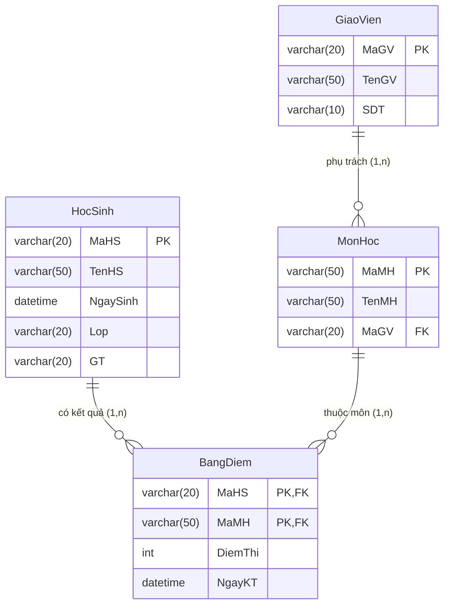

# [Thực hành] Tạo bảng trong CSDL - Quản Lý Điểm Thi

## 1. Mục tiêu
- Luyện tập và thành thạo thao tác tạo CSDL và các bảng liên kết bằng câu lệnh SQL DDL.
- Biết cách khai báo khóa chính (`PRIMARY KEY`), khóa chính phức hợp (composite primary key), và khóa ngoại (`FOREIGN KEY`).
- Nắm được cách sử dụng `ALTER TABLE` để thêm ràng buộc khóa ngoại sau khi bảng đã được tạo.

---

## 2. Mô tả lược đồ cơ sở dữ liệu `QuanLyDiemThi`

### 2.1. Danh sách các bảng
1. **Bảng `HocSinh`**:
   - `MaHS` (VARCHAR(20), PRIMARY KEY): Mã học sinh
   - `TenHS` (VARCHAR(50)): Họ và tên học sinh
   - `NgaySinh` (DATETIME): Ngày tháng năm sinh
   - `Lop` (VARCHAR(20)): Lớp học
   - `GT` (VARCHAR(20)): Giới tính

2. **Bảng `MonHoc`**:
   - `MaMH` (VARCHAR(50), PRIMARY KEY): Mã môn học
   - `TenMH` (VARCHAR(50)): Tên môn học
   - `MaGV` (VARCHAR(20), FOREIGN KEY): Mã giáo viên phụ trách (tham chiếu đến `GiaoVien.MaGV`)

3. **Bảng `BangDiem`**:
   - `MaHS` (VARCHAR(20), PK, FK): Mã học sinh (tham chiếu đến `HocSinh.MaHS`)
   - `MaMH` (VARCHAR(50), PK, FK): Mã môn học (tham chiếu đến `MonHoc.MaMH`)
   - `DiemThi` (INT): Điểm số
   - `NgayKT` (DATETIME): Ngày làm bài kiểm tra
   - Khóa chính phức hợp: `PRIMARY KEY (MaHS, MaMH)`

4. **Bảng `GiaoVien`**:
   - `MaGV` (VARCHAR(20), PRIMARY KEY): Mã giáo viên
   - `TenGV` (VARCHAR(50)): Họ và tên giáo viên
   - `SDT` (VARCHAR(10)): Số điện thoại

---

## 3. Sơ đồ quan hệ thực thể (ERD)



---

## 4. Hướng dẫn các bước thực hiện bằng SQL

1. **Bước 1**: Tạo CSDL `QuanLyDiemThi`
   ```sql
   CREATE DATABASE IF NOT EXISTS QuanLyDiemThi
   CHARACTER SET utf8mb4 COLLATE utf8mb4_unicode_ci;
   ```
2. **Bước 2**: Chọn CSDL để làm việc
   ```sql
   USE QuanLyDiemThi;
   ```
3. **Bước 3**: Tạo bảng `HocSinh`
4. **Bước 4**: Tạo bảng `MonHoc`
5. **Bước 5**: Tạo bảng trung gian `BangDiem` với khóa chính kép `(MaHS, MaMH)` và 2 khóa ngoại
6. **Bước 6**: Tạo bảng `GiaoVien`
7. **Bước 7**: Dùng `ALTER TABLE` bổ sung ràng buộc khóa ngoại `FK_MaGV` nối từ bảng `MonHoc` sang `GiaoVien`:
   ```sql
   ALTER TABLE MonHoc ADD CONSTRAINT FK_MaGV FOREIGN KEY (MaGV) REFERENCES GiaoVien(MaGV);
   ```
