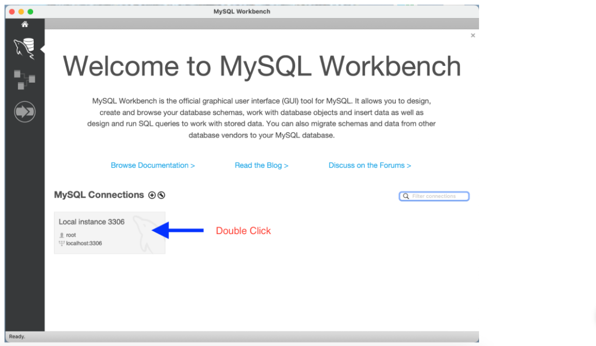
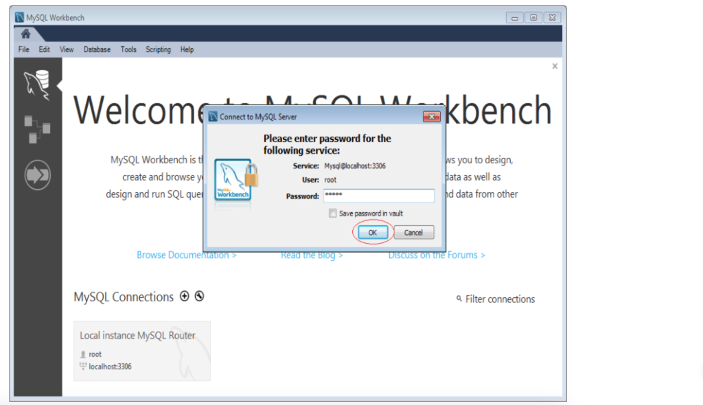
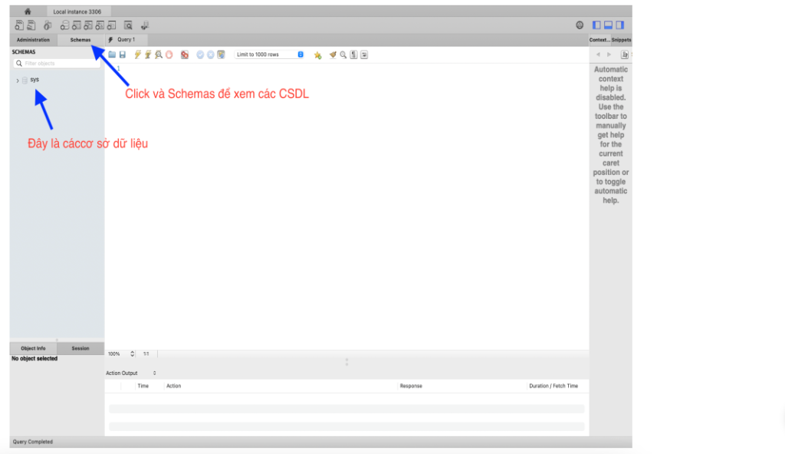
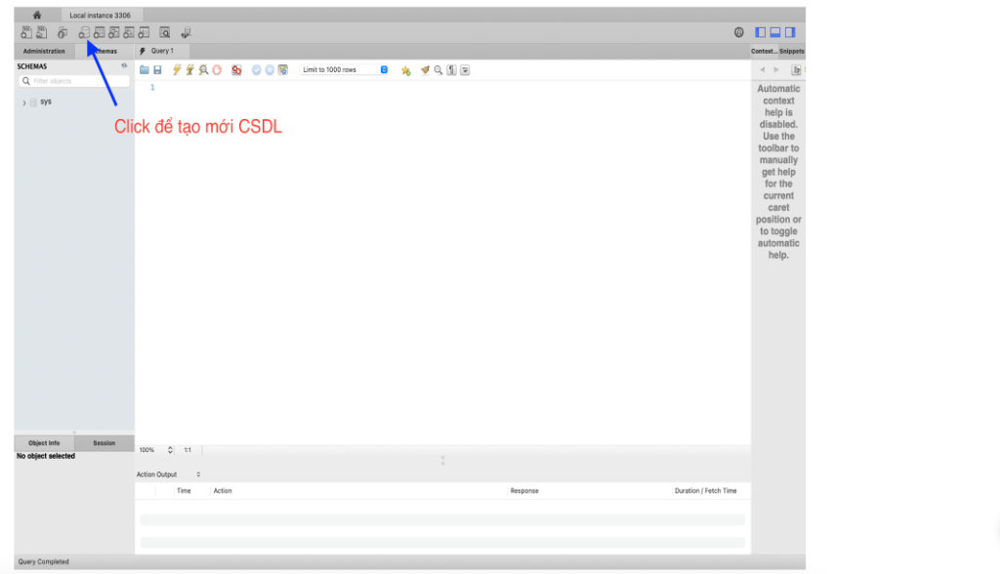
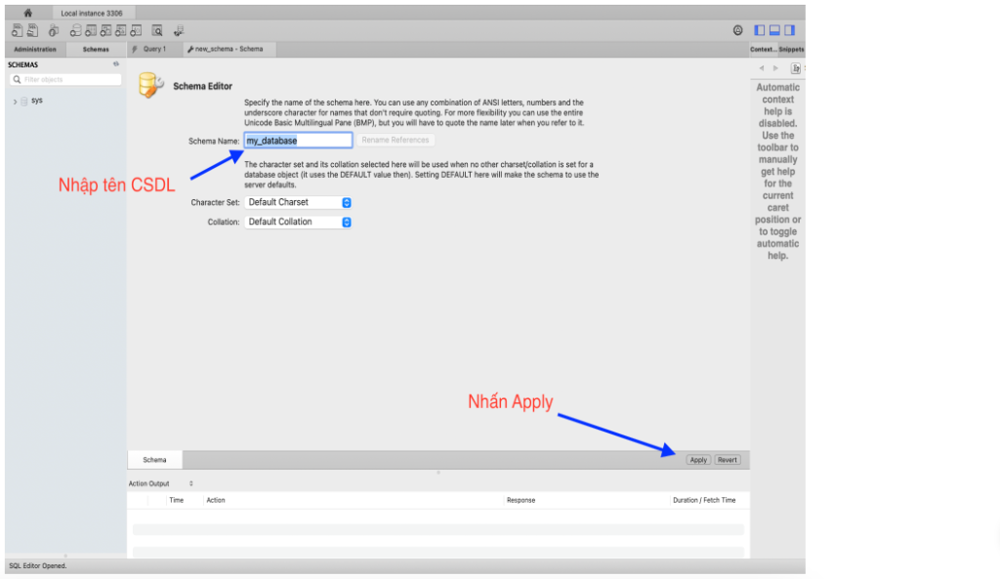

# [Thực hành] Tạo CSDL trên MySQL Workbench

## 1. Mục tiêu
- Luyện tập và nắm vững các thao tác tạo Cơ sở dữ liệu (CSDL / Schema) trên MySQL Workbench.
- Phân biệt và ứng dụng thành thạo 2 cách tạo CSDL:
  1. Sử dụng giao diện đồ họa (GUI).
  2. Sử dụng câu lệnh SQL (`CREATE DATABASE`).

---

## 2. Hướng dẫn chi tiết

### Cách 1: Tạo CSDL bằng giao diện trực quan (GUI)

- **Bước 1**: Mở **MySQL Workbench** và nhấp đúp vào kết nối MySQL (ví dụ: `Local instance 3306`).
  
  

- **Bước 2**: Nhập mật khẩu tài khoản `root` (hoặc tài khoản tương ứng) rồi nhấn **OK**.
  
  

- **Bước 3**: Tại thanh điều hướng bên trái, chọn thẻ **Schemas** để hiển thị danh sách các CSDL hiện có.
  
  

- **Bước 4**: Nhấn vào biểu tượng **Create a new schema** trên thanh công cụ.
  
  

- **Bước 5**: Nhập tên CSDL muốn tạo (ví dụ: `my_database`), có thể giữ nguyên cấu hình *Charset/Collation* mặc định hoặc chọn `utf8mb4`, sau đó nhấn **Apply**.
  
  

- **Bước 6**: Kiểm tra câu lệnh SQL sinh tự động và tiếp tục nhấn **Apply** -> **Finish** để hoàn tất quá trình tạo CSDL.

---

### Cách 2: Tạo CSDL bằng câu lệnh SQL trên MySQL Workbench

- **Bước 1**: Nhấp vào biểu tượng **Create a new SQL tab for executing queries** (biểu tượng trang giấy có dấu sấm sét hoặc tổ hợp phím `Ctrl + T`).
- **Bước 2**: Trong tab soạn thảo SQL, gõ câu lệnh:
  ```sql
  -- Tạo cơ sở dữ liệu mới
  CREATE DATABASE `my_database1`;

  -- Hoặc với cấu hình ký tự tiếng Việt đầy đủ (khuyên dùng):
  CREATE DATABASE IF NOT EXISTS `my_database1` 
  CHARACTER SET utf8mb4 
  COLLATE utf8mb4_unicode_ci;
  ```
- **Bước 3**: Nhấn biểu tượng tia sét vàng (**Execute**) hoặc nhấn tổ hợp phím `Ctrl + Enter` (hoặc `Ctrl + Shift + Enter`) để thực thi câu lệnh.
- **Bước 4**: Chuột phải vào vùng Schemas và chọn **Refresh All** để thấy CSDL `my_database1` vừa được tạo thành công.
